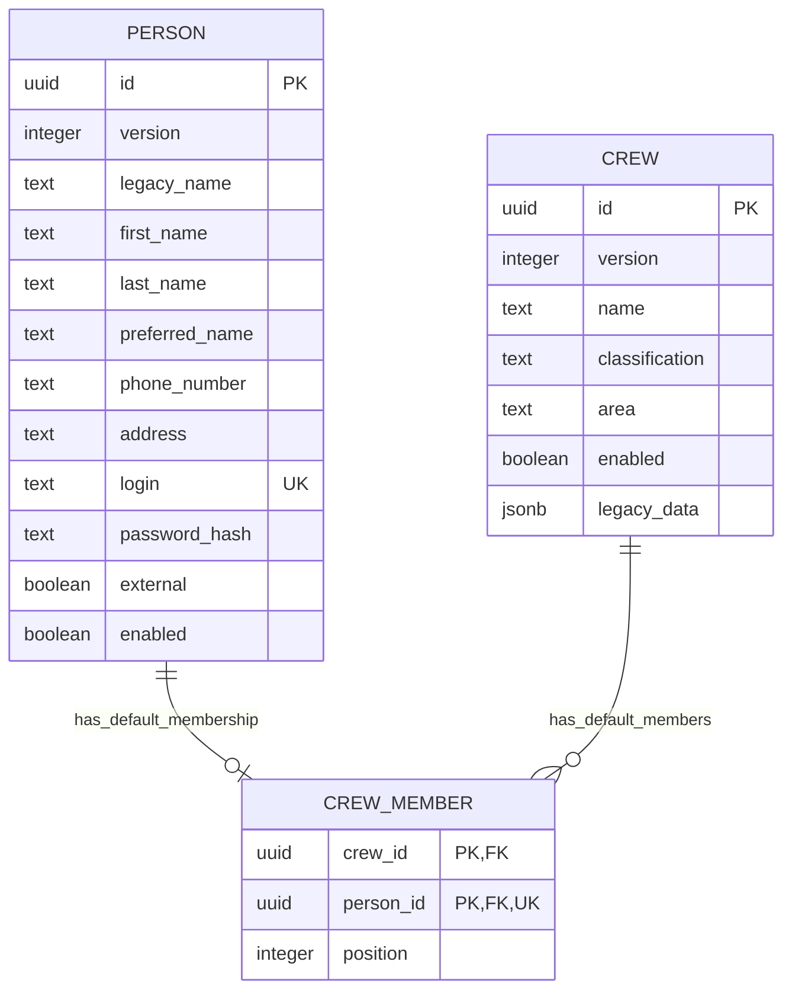

# People, default crews and visit staffing

User clarification, 2026-11-03: people can work with different crews on different schedules. A person is an independent identity; a crew is not the owner of that identity. First name, last name, preferred name, phone number, address and future-frontoffice login/password belong to the person profile.

## Decisions

- Store crew metadata, person profiles and default crew memberships in relational PostgreSQL tables. Match people only by UUID. Equal display names do not merge identities. Preserve the old crew JSON as a migration archive rather than deleting it.
- Current user clarification, 2026-11-03: a person may belong to **zero or one default crew globally**, including disabled crews. This supersedes the earlier assumption that several default rosters were allowed. Default membership remains a convenience for new visits and does not reserve the person's entire day.
- The people actually assigned to a visit are an explicit snapshot for that visit's time interval. Select or replace them independently of the default roster. Changes to a profile or default crew do not rewrite past assignments, tasks, results or signatures.
- Change an unstarted visit's crew rosters in one form and one transaction. Keep assignment/task IDs. Require a reason, the delivery version and at least one participant per assignment. A person cannot appear twice in the same visit's assignments.
- Show busy people with a disabled control and the conflicting time, and enforce the same rule in backend transactions. Only the actual intersecting interval is blocked; an earlier or later shift remains possible. Started/completed work is immutable through staffing commands.
- Use an ordinary date-filtered staffing table and accessible selections. This provides a direct workflow without introducing drag-and-drop state, a second roster authority or a Kanban dependency.
- Participant profile and credential writes require an administrator. Authenticated backoffice users can read directory information and operators can plan staffing through existing guarded domain commands.
- Participant credentials remain separate from backoffice accounts. Preparing a login never creates an `app_user`, a frontoffice login route or a crew-facing screen. Return credential metadata only; never passwords or password hashes. Reuse the application's salted scrypt implementation, consistent with the [OWASP password storage guidance](https://cheatsheetseries.owasp.org/cheatsheets/Password_Storage_Cheat_Sheet.html).

## Existing data and boundaries

The inspected local database contained six crews and nineteen distinct person UUIDs before this change. Two people named DEMO Person 16 have different UUIDs; they remain different people. Missing profile information stays missing. Do not invent surnames, addresses, phone numbers or credentials during migration. A migrated legacy display name remains available until real profile fields are supplied.

Intervals use an inclusive start and exclusive end: adjacent visits are allowed, overlapping visits using the same person or crew are not. Europe/Rome display and explicit UTC offsets remain in force. Travel time, routes, statutory working-time rules and individual leave calendars are outside the current model; availability does not promise feasible travel between adjacent visits.

Disabling a person prevents new staffing without deleting history. An empty default crew can be maintained, but a visit assignment needs a real participant. Correcting a mistakenly planned overlap requires an explicit staffing correction; busy people are never silently removed from another visit.

## Verification record

The PostgreSQL migration `RelationalParticipants1793700100000` is applied to both owned application and test databases. It was first verified on an isolated PostgreSQL schema. The live application migration ran with its API stopped and a complete source/application/private-file backup at `.local/backups/20261103T135021Z_c6a35d6b`.

`scripts/people-migration-verify.ps1 -BaselinePath .local/people-baseline-before-migration.json` passed: six crews, nineteen independent people and nineteen default memberships. Crew IDs, versions, complete ordered rosters and original JSON archives match the baseline. All twenty delivery JSON digests/versions and three private file records are unchanged. The verifier only reads PostgreSQL and saves its result under ignored `.local`.

Backend `npm run typecheck`, `npm run lint`, `npm run build` and all 67 tests passed. New real-PostgreSQL/HTTP tests cover migration replay, historical-only identities, case-insensitive login uniqueness, password omission/hash non-disclosure, real authentication/permissions, availability boundaries, stable assignment/task IDs, freed reservations, rollback and concurrent bookings. Participant credentials do not authenticate as backoffice users. Frontend and browser verification is separately recorded in `STATUS.md`.

Two executions of `npm run seed -- --test` preserved all 42 pre-existing canonical rows (18 people, six crews and eighteen memberships) in the dedicated test database. The pre-migration full backup was restored and verified in new owned clone databases with suffix `20261103140951_fd2a4d35`; no original database or file was replaced.

The browser flow subsequently added the independent synthetic `DEMO Flex Worker` profile (no login/password) and two explicitly educational appointments on 2026-11-10. The worker was moved from Catania Due to Catania Uno for DEMO/OUT/0002 09:00–11:00, then assigned to Assembly Studio for DEMO/OUT/0003 11:00–13:00 Europe/Rome. An attempted overlapping selection was correctly disabled before the second appointment was rescheduled. These genuine bookings remain for inspection; the usual crew rosters were not changed. This is separate from the migration-preservation check above and explains the twentieth person and later delivery-version increments.

Following the user's next request, the twenty current synthetic profiles were explicitly enriched through authenticated HTTP with fictional Italian names, preferred display names, contacts and future login credentials. This is deliberate fixture data, not confirmation of anyone's real identity or address. The two old DEMO Person 16 UUIDs now display Elena Moretti and Valentina Messina; the flexible-worker UUID now displays Simone Lo Presti. Existing nonempty contact values were retained. Existing visit snapshots retain their original names; neither past nor upcoming snapshots were silently rewritten.

The opt-in command is `npm run demo:italian-participants`; catalog UUIDs and source values live in `scripts/italian-participant-data.ts`. Raw generated passwords stay in ignored `.local/participant-demo-accounts.json`; API responses never contain them. The real local run reported 20 updates, followed by zero updates on repeat with unchanged credential-file bytes and modification time. A read-only comparison against `.local/italian-profiles-before.json` proved that crew records, default memberships, delivery JSON/versions and reservations did not change. A consistent application database dump is retained at `.local/backups/italian-profiles-before-20261103T142434Z.dump`. The full backend suite now passes 69 tests, including actual authenticated HTTP response-loss recovery and preservation of user fields, credentials and signed history.

## PostgreSQL layout



`login` has a partial unique index on `lower(login)`, rather than a case-sensitive column uniqueness constraint. Profiles migrated without a legal first/last name retain `legacy_name`; contact and credential fields remain NULL. New profiles require first and last names. Existing passwords are preserved when the write-only password field is omitted. The credential preparation feature exposes no participant sign-in endpoint.

Actual visit staff remain in the delivery aggregate's assignment snapshots, indexed for conflict checks by `appointment` and `reservation`. Default membership is not a second schedule. `legacy_data` is an immutable migration archive; subsequent directory reads and writes use the relational columns and memberships.

## Exclusive default roster: current clarification and rollout

The one-default-crew rule is enforced by admin crew writes inside the existing transaction/advisory lock and by `crew_member_person_unique UNIQUE(person_id)`. It compares UUIDs, including equivalent UUID casing, rather than names. A 409 identifies the participant and their other crew. Disabled crews still count. Existing own members can be retained or removed; members of another default crew are shown disabled with that crew's name below the person. If a refreshed catalogue makes a selected draft conflict, the selection remains removable and Save stays blocked until it is resolved. This rule does not restrict actual visit staffing to the default crew: another available person may work with a different crew on a different visit. Stored assignment/task/result/signature snapshots remain separate from current roster edits.

The initial read-only audit found three duplicate default memberships, all additionally in Assembly Studio. The user explicitly chose Antonio Lombardo → Messina Due, Alessandro Costa → Catania Uno and Andrea Grasso → Catania Due. After the complete backup `.local/backups/20261103T164641Z_b1425d82` and baseline `.local/single-crew-before-20261103T164641Z.json`, one real authenticated admin PATCH changed Assembly Studio (`10000000-0000-4000-8000-000000000005`) from v10 to v11, removing only person IDs `20000000-0000-4000-8000-000000000005`, `20000000-0000-4000-8000-000000000009` and `20000000-0000-4000-8000-000000000012`. Its default roster is now empty; other crews were retained. The request/readback record is `.local/single-crew-repair-20261103T164641Z.json`.

`UniqueDefaultCrew1793700200000` was then applied to the owned main and test databases. It validates the target, requires a transaction, takes the shared advisory lock and a roster table lock, reports duplicate person/crew IDs and names, and refuses before DDL if a decision is still required. It never chooses a winning crew or deletes rows. Its sole schema change adds the unique constraint; historical delivery aggregates and archived crew JSON are outside the migration's writes. Existing-data corrections must be explicit authenticated admin operations with a fresh crew version and preserved metadata.

Independent read-only verification passed for both databases: three applied migrations, validated `UNIQUE(person_id)` and no duplicate groups. The main baseline retained all twenty complete delivery aggregates/versions and signed snapshots, twenty profiles, seven appointments, thirty-five reservations, four file records and file-byte SHA256 values, six task templates and all crew metadata/archives apart from the intended Assembly Studio version increment. Default memberships changed only by the selected three removals, eighteen → fifteen; the original crew IDs/positions remained. Audit gained exactly one `crew.saved` event for Assembly Studio v11 with an empty roster.

For another existing local target, stop API/import writers before the consistent backup. Resolve any reported ambiguity by an explicit user decision and an authenticated crew edit, then stop writers again before migration:

```powershell
./scripts/postgres-backup.ps1 -WritersStopped
```

Start the compiled API with `npm start` only for the approved admin correction. Read fresh crews, preserve metadata and other participant IDs, and verify the authenticated edit's readback. Stop API/import writers again before applying the reviewed constraint:

```powershell
npm run migrate
npm run migrate -- --test
npm run build
npm start
```

Do not use seed or automatic cleanup to choose membership. The migration fails without changing rows when ambiguous memberships remain; a fresh seed already uses unique default members. There is no automatic destructive down operation.

Backend implementation checks passed typecheck, typed lint, build, OpenAPI and **80/80 tests**. Real PostgreSQL/guard tests cover refusal without mutation, preservation of signed history and archives, independent database uniqueness, concurrent administrators, clear bounded conflict names, UUID casing, same-name independent identities, authorization and rollback. Existing visit-staffing overrides and interval-conflict tests remain active. Frontend `npm run verify` passed typecheck, typed lint, **51/51 tests** and build; real read-only API smoke passed **1/1**. These results are separate from the earlier normalization/enrichment records above.

After the public test-database migration, the full backend suite passed **80/80** again. Following both local service restarts, the read-only API smoke passed **1/1** again. The fresh production browser showed Assembly Studio with zero default members and the other five crews with three each. New crew disabled Alessandro, Andrea and Antonio with the respective Catania Uno, Catania Due and Messina Due reason; free Simone remained selectable. Editing Catania Uno kept its own Alessandro checked and editable, while the other crews' participants stayed unavailable. Checkbox checks were restored without saving, so the only live membership write remains the approved admin repair. The 320 px editor retained contained widths, the viewport override was reset and the browser console contained no warnings/errors. [Verified crew editor](../../backoffice-frontend/docs/screenshots/crew-membership.jpg).
